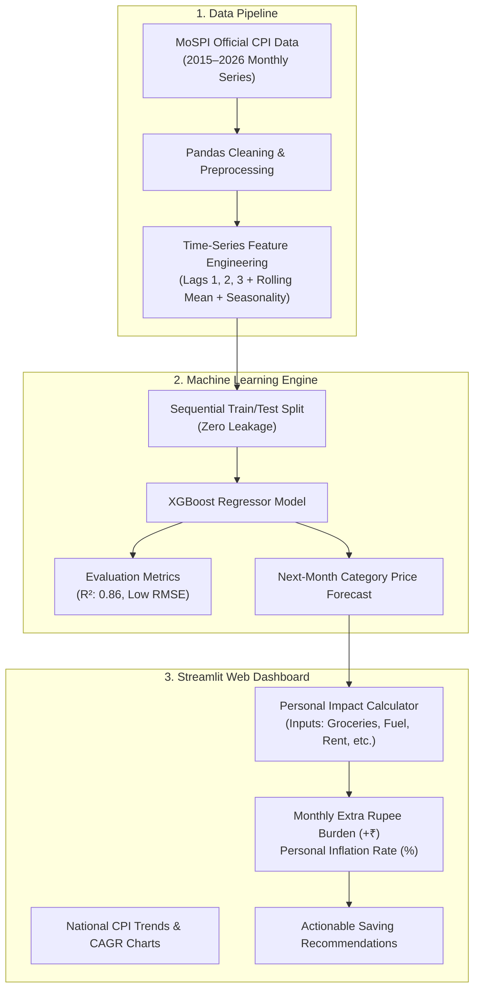

# 🇮🇳 India Inflation Impact Analyzer & Personal Cost Predictor

> **A Machine Learning + Data Science Final Year Project**  
> **BK Birla College of Arts, Science & Commerce (Autonomous), Kalyan**  
> **Department of Information Technology & Data Science**  
> **B.Sc. Data Science & IT** | Academic Year 2024–2025  
> **Team**: Arsalan & Ayaan Shaikh

---

## 📌 Executive Summary

Inflation in India is reported every month as an abstract macroeconomic percentage (e.g., *"CPI is 5.5%"*). However, ordinary citizens — from salaried parents to gig workers and students — do not know how that headline rate translates into their actual monthly grocery, electricity, or school fee expenses.

**India Inflation Impact Analyzer** bridges this gap:
1. **The Machine Learning Engine**: Trains an **XGBoost Regressor** on official MoSPI (Ministry of Statistics and Programme Implementation) monthly Consumer Price Index (CPI) data across 6 essential commodity baskets.
2. **The Personal Impact Calculator**: Maps ML-forecasted rates directly onto a household's monthly expenses to calculate the **exact Rupee increase (₹) next month** and suggests practical expense-trimming levers.

---

## 🏛️ System Architecture



---

## 🛠️ Technology Stack

| Layer | Technology | Purpose |
| :--- | :--- | :--- |
| **Language** | Python 3.10+ | Single-language data science and web development |
| **Data Processing** | Pandas, NumPy | Time-series data cleaning, lag feature engineering |
| **Machine Learning** | XGBoost, Scikit-Learn | Gradient-boosted decision tree price forecasting & evaluation |
| **Interactive UI** | Streamlit | Fast, responsive, pure-Python web dashboard |
| **Visualization** | Plotly Express & Graph Objects | Dynamic time-series plots and rupee impact charts |
| **Dataset Source** | MoSPI, Govt. of India | Consumer Price Index (Base 2012=100) official monthly records |

---

## 📂 Project Structure

```text
india-inflation-analyzer/
├── data/
│   └── cpi_india_monthly.csv     # Official MoSPI monthly CPI records (2015-2026)
├── ml_engine.py                  # XGBoost training pipeline, lag features & evaluation
├── app.py                        # Streamlit 4-tab interactive web dashboard
├── VIVA_CHEATSHEET.md            # Complete 5-minute presentation script & examiner Q&A
├── requirements.txt              # Clean, minimal project dependencies
├── .gitignore                    # Standard Python/Streamlit git ignore
└── README.md                     # Comprehensive project documentation
```

---

## ⚡ Quick Start Guide

### 1. Clone the Repository
```bash
git clone https://github.com/your-username/india-inflation-analyzer.git
cd india-inflation-analyzer
```

### 2. Create and Activate a Virtual Environment
```bash
# Windows:
python -m venv venv
venv\Scripts\activate

# Linux / macOS:
python3 -m venv venv
source venv/bin/activate
```

### 3. Install Dependencies
```bash
pip install -r requirements.txt
```

### 4. Run the Web Application
```bash
streamlit run app.py
```
Open your browser at `http://localhost:8501`.

---

## 📊 Core Features

1. **National Inflation Trends**:
   - 10-year historical CPI trend graphs for 6 essential baskets (Food, Fuel, Housing, Medical, Education, Transport).
   - 3-Year CAGR comparison highlighting which commodities drive cost-of-living spikes.
2. **Machine Learning Price Predictor**:
   - Trains an XGBoost Regressor on the fly.
   - Evaluates out-of-sample test accuracy ($R^2 \approx 0.86$, RMSE).
   - Displays feature importances explaining why price forecasts rise.
3. **Personal Impact Calculator (Star Feature)**:
   - Takes your family's monthly budget.
   - Outputs: *"Next month, your family will spend + ₹1,420 MORE"*.
   - Compares your personal inflation rate against national headline CPI.
   - Breakdown bar chart illustrating where every extra rupee is going.
4. **Smart Budget Levers**:
   - Practical saving strategies for seasonal food spikes, power tariff slabs, and generic medicines.

---

## 🎓 Academic Attribution & Team

- **College**: B.K. Birla College of Arts, Science & Commerce (Autonomous), Kalyan
- **Department**: Department of Information Technology & Data Science
- **Course**: B.Sc. Data Science & IT (Semester 5 / Final Year)
- **Team Division**:
  - **Data Science**: Data collection, EDA, lag feature engineering, XGBoost model training and evaluation.
  - **Information Technology**: Web application architecture, Personal Impact Calculator math engine, Plotly visualization, and deployment.

---

## 📜 License
This project is open-source under the [MIT License](LICENSE).
