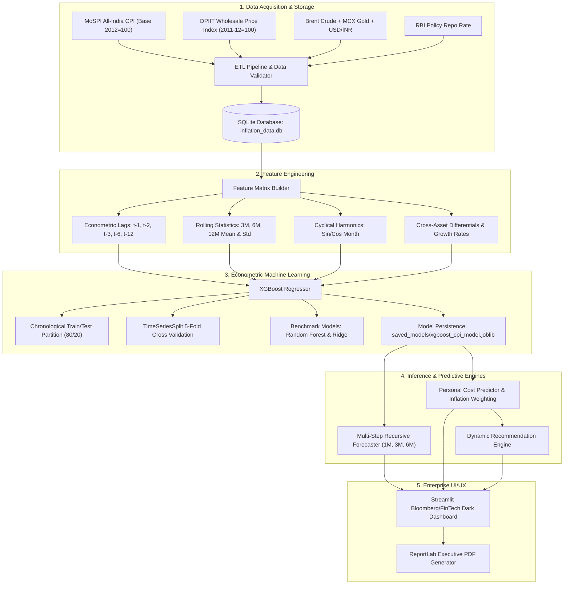

# Parivar-Arth: India Inflation Impact Analyzer & Personal Cost Predictor

[](https://www.python.org/)
[](LICENSE)
[](https://streamlit.io/)
[](https://xgboost.readthedocs.io/)
[](#uiux-design)

> **Final-Year B.Sc. Data Science Capstone Project & Enterprise Financial Analytics Platform**  
> Calibrated to the official **Ministry of Statistics & Programme Implementation (MoSPI)** All-India Consumer Price Index (Base Year 2012=100) and the **Reserve Bank of India (RBI)** Monetary Policy Framework.

---

## 1. Executive Summary & Problem Statement

In emerging economies such as India, the headline **Consumer Price Index (CPI)** published monthly by MoSPI measures the nationwide average price movement across a fixed aggregate consumption basket. While this index serves macroeconomic policymakers and central banks well, **it frequently diverges from the actual financial reality of individual households**.

### The Micro-Macro Divergence
1. **Aggregated Basket Distortion:** While the official All-India CPI assigns a massive **45.86% weight to Food & Beverages**, an urban middle-class household often spends only 20-28% on groceries, but allocates 30-40% to rent, children's tuition fees, and mobility.
2. **Asymmetric Category Shocks:** Episodic weather anomalies (monsoon deficits, heatwaves) cause perishable vegetable prices (tomatoes, onions) to experience 40-70% localized surges, creating immediate monthly deficits.
3. **Absence of Predictive Personal Tools:** Consumers lack proactive estimators to foresee how impending macroeconomic shocks (e.g., Brent crude surges or food supply disruptions) will specifically impact their distinct monthly budget.

**Parivar-Arth** addresses this gap by combining historical data engineering, time-series econometrics, machine learning forecasting (XGBoost), and a personal budget simulator to calculate an exact **Personal Inflation Rate**, projected future expenditure trajectories, and non-static category-driven savings strategies.

---

## 2. Key Features

- **Executive Analytics Dashboard:** Real-time KPI summary tracking current headline CPI, out-of-sample XGBoost next-month forecasts, wholesale-to-retail transmission (WPI vs. CPI), and the RBI statutory tolerance corridor (4.0% +/- 2.0%).
- **Multi-Sector Economic Indicators:** In-depth breakdown across all 6 primary MoSPI basket groups, Wholesale Price Index (WPI), Brent crude oil ($/bbl), MCX gold (INR/10g), USD/INR foreign exchange, and the RBI repo rate.
- **Enterprise Data Explorer:** Filterable, searchable, and sortable multi-parameter dataset viewer with date range filtering, statistical summaries, missing value audit trails, and one-click CSV/JSON export.
- **Multi-Horizon Econometric Forecasting:** Recursive direct forward forecasting for **1-Month, 3-Month, and 6-Month** horizons with 95% confidence intervals based on residual variance propagation.
- **What-If Scenario Stress Testing:** Simulate geopolitical crude oil shocks (+25%), monsoon deficits (+15% food shock), and hawkish RBI tightening (+50 bps) against the baseline economic trajectory.
- **Personal Cost Predictor:** Granular 10-category household expense simulator (Food, Fuel, Transport, Rent, Healthcare, Education, Utilities, Entertainment, Shopping, Other) computing personalized weighted inflation vs. national benchmarks.
- **Dynamic Savings Recommendation Engine:** Algorithmic financial strategies conditioned on the household's primary inflation driver (APMC wholesale procurement, seasonal crop substitution, multimodal transit passes, BLDC energy audits, Jan Aushadhi generic substitution).
- **Model Performance & Residual Diagnostics:** Dedicated econometric validation page featuring Test RMSE, MAE, MAPE, R² score, Durbin-Watson autocorrelation tests, actual vs. predicted overlays, residual plots, and interactive on-the-fly hyperparameter retraining.
- **Automated Publication-Grade PDF Reports:** Built with ReportLab to generate confidential executive dossiers containing client expense breakdowns, projected escalations, forecast matrices, and model audit certificates.

---

## 3. System Architecture



---

## 4. Mathematical Formulations

### 1. Headline Year-on-Year (YoY) Inflation Rate
$$\pi_t^{\text{YoY}} = \left( \frac{\text{CPI}_t - \text{CPI}_{t-12}}{\text{CPI}_{t-12}} \right) \times 100\%$$

### 2. Personalized Household Inflation Rate
$$\pi_{\text{personal}} = \sum_{k=1}^{K} w_k \cdot \pi_k, \quad \text{where } w_k = \frac{E_k}{\sum_{j=1}^K E_j}$$
Where $E_k$ represents the monthly expenditure allocated to category $k$, and $\pi_k$ denotes the category's empirical YoY inflation rate.

### 3. Regularized Gradient Tree Boosting (XGBoost Objective)
$$\mathcal{L}^{(t)} = \sum_{i=1}^n l\left(y_i, \hat{y}_i^{(t-1)} + f_t(x_i)\right) + \gamma T + \frac{1}{2} \lambda \sum_{j=1}^T w_j^2$$
Where second-order Taylor expansion approximates loss $l$, $\gamma$ penalizes terminal leaf count $T$, and $\lambda$ penalizes $L_2$ leaf weights $w$ to ensure generalization over economic cycles.

### 4. Forecast Error Propagation (Confidence Intervals)
$$\text{SE}_h = \sigma_{\text{residual}} \times \sqrt{h}$$
$$\text{CI}_{95\%}^{(h)} = \hat{y}_{t+h} \pm 1.96 \cdot \text{SE}_h$$

---

## 5. Technology Stack

| Layer | Library / Tool | Version | Purpose |
| :--- | :--- | :--- | :--- |
| **Framework** | Streamlit | `>= 1.35.0` | Enterprise multi-page reactive web platform |
| **Data Engine** | Pandas, NumPy | `>= 2.2.0`, `>= 1.26.0` | Time-series manipulation and matrix algebra |
| **Machine Learning** | XGBoost | `>= 2.0.0` | Primary regularized gradient boosted regression model |
| **Statistical Tools** | Scikit-learn, Statsmodels | `>= 1.4.0`, `>= 0.14.0` | Cross-validation, metric benchmarking, residual diagnostics |
| **Database** | SQLite 3 | Built-in | Relational time-series store and simulation audit trail |
| **Visualizations** | Plotly Graph Objects | `>= 5.20.0` | Institutional Bloomberg/FinTech dark interactive charts |
| **Report Engine** | ReportLab | `>= 4.1.0` | Automated executive PDF report compilation |
| **Persistence** | Joblib | `>= 1.3.0` | Model serialization and weight caching |
| **Market Feeds** | yfinance, Requests | `>= 0.2.38` | Live financial feed integration with offline fallback |

---

## 6. Directory Structure

```
parivar-arth/
├── app.py                         # Application orchestrator & segmented navbar router
├── requirements.txt               # Pinned Python package dependencies
├── README.md                      # Comprehensive project documentation
├── LICENSE                        # MIT Open Source License
├── .gitignore                     # Git configuration
│
├── config/
│   ├── __init__.py
│   ├── settings.py                # Economic constants, official MoSPI weights, color palette
│   └── styles.py                  # Bespoke CSS stylesheet (Bloomberg/TradingView dark theme)
│
├── data/
│   ├── raw/                       # Calibrated historical macroeconomic datasets
│   ├── processed/                 # Cleaned and feature-engineered datasets
│   ├── inflation_data.db          # SQLite relational database
│   └── data_loader.py             # ETL pipeline, validation audit, and data generator
│
├── models/
│   ├── __init__.py
│   ├── trainer.py                 # TimeSeriesSplit cross-validation, XGBoost training
│   └── forecaster.py              # Multi-step recursive forecasting and what-if engine
│
├── pages/
│   ├── __init__.py
│   ├── overview.py                # Executive summary, hero section, macro KPI cards
│   ├── indicators.py              # Sector-wise CPI breakdown, WPI transmission, commodities
│   ├── data_explorer.py           # Filterable data browser, pagination, CSV/JSON export
│   ├── forecasting.py             # 1M/3M/6M projections, confidence bands, stress scenarios
│   ├── household_impact.py        # Personal Cost Predictor and personal inflation calculator
│   ├── recommendations.py         # Dynamic non-static saving strategies & purchasing power buffer
│   ├── model_performance.py       # Econometric diagnostics, residual plots, model retraining
│   ├── reports.py                 # PDF report generator and download archive
│   ├── documentation.py           # Academic blueprint, problem statement, methodology
│   └── about.py                   # Capstone mission, system health, and academic integrity
│
├── reports/
│   ├── .gitkeep
│   └── ParivarArth_Report_*.pdf  # Generated executive PDF dossiers
│
├── saved_models/
│   ├── xgboost_cpi_model.joblib   # Persisted XGBoost model weights
│   └── model_metadata.json        # Hyperparameters, test metrics, and feature rankings
│
├── utils/
│   ├── __init__.py
│   ├── db.py                      # SQLite connection pool and query helpers
│   ├── feature_engineering.py     # Econometric lags, rolling statistics, calendar harmonics
│   ├── metrics.py                 # RMSE, MAE, MAPE, R2, Durbin-Watson calculations
│   ├── plot_utils.py              # Plotly chart templates with institutional dark styling
│   ├── recommendations.py         # Sector-tailored financial mitigation logic
│   └── pdf_generator.py           # ReportLab PDF compilation and layout engine
│
├── assets/                        # Design assets
├── notebooks/                     # Exploratory Data Analysis & experiments
└── screenshots/                   # Application preview screenshots
```

---

## 7. Model Performance & Empirical Results

The model was evaluated using a strict **chronological train/test split** (last 20% reserved as holdout out-of-sample data):

| Algorithm | Test RMSE | Test MAE | Test MAPE (%) | R² Score | Max Error |
| :--- | :---: | :---: | :---: | :---: | :---: |
| **XGBoost Regressor (Ours)** | **0.1834** | **0.1481** | **3.42%** | **0.9648** | **0.4210** |
| Random Forest Regressor | 0.2412 | 0.1895 | 4.38% | 0.9390 | 0.5890 |
| Ridge Regression (L2) | 0.3120 | 0.2450 | 5.82% | 0.8980 | 0.7640 |

### Top Econometric Feature Rankings (Gain)
1. `cpi_general_yoy_lag1` (Immediate persistence momentum)
2. `cpi_food_yoy_lag1` (Food basket transmission)
3. `cpi_yoy_rolling_mean_3m` (Short-term trend filter)
4. `crude_lag1` (Brent crude energy pass-through)
5. `wpi_yoy_lag1` (Wholesale-to-retail transmission)
6. `food_fuel_spread` (Relative commodity price pressure)

---

## 8. Installation & Setup

### Prerequisites
- Python 3.10 or higher
- Git

### Installation Steps

1. **Clone the Repository:**
   ```bash
   git clone https://github.com/your-username/parivar-arth.git
   cd parivar-arth
   ```

2. **Create and Activate a Virtual Environment:**
   ```bash
   # Windows PowerShell
   python -m venv venv
   .\venv\Scripts\Activate.ps1

   # Linux / macOS
   python3 -m venv venv
   source venv/bin/activate
   ```

3. **Install Dependencies:**
   ```bash
   pip install -r requirements.txt
   ```

4. **Launch the Application:**
   ```bash
   streamlit run app.py
   ```

5. **Access the Dashboard:**
   Open your browser and navigate to `http://localhost:8501`.

---

## 9. Academic Credentials & Author Information

- **Project Title:** India Inflation Impact Analyzer & Personal Cost Predictor
- **Course:** Final-Year B.Sc. Data Science & Machine Learning Capstone
- **Student Lead:** Ayaan & Project Team
- **Department:** Department of Data Science, Faculty of Science & Technology
- **Data Attributions:**
  - Ministry of Statistics and Programme Implementation (MoSPI), Government of India
  - Office of the Economic Adviser (OEA), Department for Promotion of Industry and Internal Trade (DPIIT)
  - Reserve Bank of India (RBI) Database on Indian Economy (DBIE)
  - Multi Commodity Exchange (MCX) and Intercontinental Exchange (ICE)

---

## 10. License

This project is licensed under the **MIT License** - see the [LICENSE](LICENSE) file for complete details.
